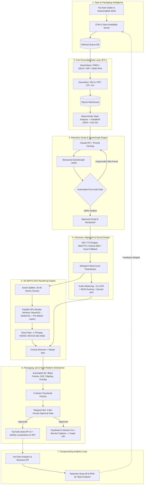

# System Architecture Blueprint — Automated Data Documentary Factory

> **Mission:** Build a solo-operated, AI-powered automated data documentary network generating **$1,500–$2,000/day ($45,000–$60,000/month) of profit** from pure platform ad revenue (YouTube AdSense + Facebook In-Stream) within 24–36 months, powered by a **~$100/month** single-GPU automated pipeline.

---

## 1. Architectural Principles & Design Constraints

Every architectural decision is governed by five non-negotiable constraints:

| Constraint | Engineering Implication |
| :--- | :--- |
| **~$100/mo Infrastructure Budget** | Zero SaaS bloat. Free public economic APIs, self-hosted GPU TTS (MeloTTS/Kokoro) + WhisperX forced alignment, prompt-cached calls to the current front-tier model through a provider-agnostic adapter (one alternate provider as fallback), hardware NVENC encoding, and a CPU control plane plus on-demand RTX 4090 budget. |
| **100% Fact-Grounded Data** | LLMs **never** generate statistics from memory. Every number originates from versioned API snapshots (World Bank, FRED, OECD, IMF, OWID, DBnomics, UN Data) stored in the local SQLite warehouse and audited via deterministic post-script verification. |
| **4K 60FPS Documentary Grade** *(launch preset 1440p60, `DECISIONS.md` D-12; 4K60 is the post-YPP upgrade)* | Naive single-threaded Manim Cairo renders take 10–20 hours per 15-min 4K60 video. Solved via **atomic scene DAG parallelism**, **static texture caching**, **OpenGL/Skia GPU rasterization**, and **zero-temp-PNG NVENC streaming**. |
| **High-Retention & Anti-Demonetization** | Built to defeat YouTube's "Repetitious / Mass-Produced Content" filters: deep causal narration, visual template entropy enforcement (new visual every 35–50s), human 3-minute QA gate, and rich sound design. |
| **Solo Developer Maintainability** | Monolithic Python 3.12 repository, SQLite state store (PostgreSQL when scaling; no heavy K8s/microservices), idempotent resumable pipeline stages, and Telegram/Discord mobile notifications for one-tap approval. |

---

## 2. End-to-End Pipeline Architecture



### Pipeline Execution SLA (Target per 12–16 Min 4K60 Video)

| Stage | Execution Time | Compute Target | Idempotency Key |
| :--- | :---: | :--- | :--- |
| 1. Data Ingestion & `DataBrief` | 15–45 sec | CPU | `episode_id + dataset_snapshot_hash` |
| 2. Script + SceneGraph + Fact Audit | 30–60 sec | Claude API | `episode_id + brief_hash + prompt_v` |
| 3. GPU TTS + Word Alignment | 2–4 min | GPU | `scene_id + narration_text_hash` |
| 4. Parallel 4K60 Scene Rendering | 20–35 min | GPU + Multi-CPU | `scene_id + scene_spec_hash + audio_dur` |
| 5. Mastering, QC & Thumbnails | 3–5 min | GPU (NVENC) | `episode_id + all_scene_hashes` |
| 6. Localization & Resumable Upload | 3–8 min | Network | `episode_id + platform` |
| **Total End-to-End** | **~30–50 min** | **Single GPU VPS** | **Full crash-resume at any scene** |

---

## 3. Module-by-Module Deep Technical Design

### Module 1: Topic Intelligence & Packaging Engine
High RPM and high CTR are engineered **before** a single line of script is written.

* **Topic Scoring Formula (`0–100`)** — reweighted in `DECISIONS.md` D-03 and D-10 so the score no longer pays for production convenience:
  $$\text{Score} = 0.50(\text{Proven Search Demand}) + 0.25(\text{Estimated Niche CPM}) + 0.25(\text{Angle Novelty})$$
  * **Data verifiability is a hard filter, not a weight.** "Can I make this easily?" is a production question; a topic that cannot be fully grounded in frozen warehouse rows is rejected before scoring, and the removed 25% moved to demand — measured from competitor views/day (`TOP-02`), not guessed.
  * **6 pillars x 5 episodes** is the launch shape (`SPRINT_30_DAYS.md`): one dataset, many questions, never one template across many countries.
* **High-CPM Evergreen Pillars (Tier-1 Finance/Econ CPM: $12–$28 gross / $8–$16 RPM):**
  1. *Salaries & Take-Home* (e.g., "Average Salary by Country (2026): Take-Home Pay")
  2. *Cost of Living & Housing* (e.g., "What $1,000 Buys in 50 Countries")
  3. *Macro Wealth & Debt* (e.g., "Top 15 Economies Ranked, 1950 to 2050")
  4. *Taxes & Retirement* (e.g., "Effective Tax Rate by Country: What You Actually Pay")
  5. *Demographics & Labour* (e.g., "Fertility Rate by Country: The 2026 Demographic Cliff")
  6. *US-vs-World, the Tier-1 hook* (e.g., "US vs Europe: Where a Salary Goes Further")
* **Packaging First Rule:** Every queued episode must lock its **Title (≤60 chars)**, **3 Thumbnail Concepts**, and **Primary Hook Visual** before entering the ETL stage.

---

### Module 2: Fact-Grounded Data Layer (ETL & Verification)
Eliminates LLM hallucinations permanently by treating economic data like a financial ledger.

* **Primary Free API Connectors (`src/data/connectors/`):**
  * **World Bank API v2** (`api.worldbank.org/v2`): 16,000+ global indicators (GDP per capita PPP, Gini, poverty, literacy, inflation, life expectancy) across 217 economies.
  * **FRED API** (`api.stlouisfed.org`): High-frequency US & global macro series (housing prices, interest rates, wages, CPI, M2 money supply).
  * **OECD SDMX API** (`sdmx.oecd.org`): Gold-standard Tier-1 data (average annual wages, tax wedge, housing affordability, hours worked, household debt).
  * **IMF DataMapper API** (`imf.org/external/datamapper/api/v1`): Debt-to-GDP, real GDP forecasts, inflation projections.
  * **Our World in Data (OWID) Grapher CSV/JSON**: Clean, harmonized long-run historical datasets (1800–present).
  * **DBnomics API** (`api.db.nomics.world`): Single aggregation point for OECD/Eurostat/IMF/BIS series with one schema — the thread's shortcut to multi-source coverage.
  * **UN Data API** (`data.un.org`): Population, migration, education and labour series not covered by the World Bank.
* **Local Data Warehouse (`SQLite`, `data/production.db`; PostgreSQL when scaling):**
  * `dim_countries`: ISO-3, ISO-2, display name, short label, region, flag SVG path, GeoJSON polygon ID, currency code.
  * `fact_observations`: `(source, indicator_id, iso3, year, value, unit, is_ppp, is_inflation_adjusted, fetched_at)`.
  * `episode_snapshots`: frozen row-set used by each video (JSON blob keyed by `episode_id`), so any published number can be re-derived and cited.
  * Operational tables from the locked schema (`data/schema.sql`): `rss_items`, `videos`, `ats_snapshots`, `hijack_attempts`, `hijack_results`. WAL mode, `PRAGMA foreign_keys = ON`.
* **`FastMCP` Data-Grounding Server (`src/data/mcp_server.py`):**
  * Exposes `get_indicator`, `rank_countries`, `get_series` and `search_datasets` tools over the warehouse. The script LLM can only read verified rows through these tools — it never formats a number itself.
* **Deterministic Statistics Engine (`src/data/analyzer.py`):**
  * Computes Top-N, Bottom-N, Global Median/Mean, Regional Averages, 10/20/50-year CAGR, Biggest Risers/Fallers, and Statistical Outliers (e.g., high nominal salary vs low PPP purchasing power).
  * Outputs `DataBrief.json` assigning every statistic an immutable ID (`F001`–`F250`).

---

### Module 3: Narrative & Retention Script Engine (Claude API)
Transforms raw `DataBrief.json` into a **10–18 minute high-retention documentary** (1,600–2,700 words at ~155 WPM).

* **Model & Cost Optimization:**
  * Primary: the **current front-tier model** resolved from `config/models.yaml` (Sonnet-class at build time), for structured JSON + engaging documentary prose, with **prompt caching** enabled on the system prompt, visual template catalog and style guide (~70% input-token savings).
  * Fallback: the registry's alternate provider when the primary call fails the fact-audit gate twice.
  * Model names are configuration, never code (`DECISIONS.md` D-07): a retired model is a config edit, and script cost is budgeted at **$0.15–$0.30 per episode** because the audit loop retries.
  * A local **Ollama + Llama 3.1 8B** handles metadata, tags and descriptions only — never narration (generic prose kills first-30s retention).
* **Retention Blueprint (Enforced by Pydantic Schema):**
  1. **`0:00–0:35` Cold Hook & Visual Proof:** Immediate provocative contrast backed by a fast animated reveal + open loop ("By the end, you'll see why a $45,000 salary in Country X buys more than $110,000 in Country Y").
  2. **`0:35–1:30` Methodology & Stakes:** Establish credibility (PPP vs nominal, exact dataset & year) in under 45 seconds without boring the viewer.
  3. **`1:30–11:30` 4–6 Escalating Narrative Acts:** Tiered progression (e.g., Bottom Tier → Emerging Middle → The Hidden Outliers → Top 10 Showdown). Every act includes a **causal explanation** (policy, geography, demographics, taxation) + **pattern interrupt** every 45–60 seconds.
  4. **`11:30–14:30` The Climax / Surprising Inversion:** Re-rank the dataset on a second axis (e.g., after taxes & housing costs) to deliver a high-satisfaction payoff.
  5. **`14:30–15:30` Synthesis & End-Screen Bridge:** 10-second bridge teasing the exact next related video on the channel to drive session duration (no "like and subscribe" begging).
* **Zero-Hallucination Fact-Audit Gate (`src/script/fact_auditor.py`):**
  * Extracts all numbers, percentages, dollar figures, years, and country ranks from the generated narration.
  * Verifies every extracted claim against `DataBrief.json` (allowing clean rounding tolerance, e.g., `$63,412` → `"over $63,000"`).
  * Fails fast and invokes a targeted repair prompt if *any* unverified figure appears.

---

### Module 4: Voiceover, Word-Level Alignment & Sound Design
Documentary authority lives or dies on audio quality and frame-accurate synchronization.

* **Zero-Marginal-Cost GPU TTS Stack (fits ~$100/mo budget):**
  * **Primary Local Engine:** **MeloTTS** (MIT — English narration, fixed authoritative voice embedding) with **Kokoro-82M** (Apache 2.0) as the alternate local voice. Zero API fees, runs on the GPU worker.
  * **Fallback:** **Azure Neural TTS** (~$0.20 per 12-minute video) for non-English localisations and for any scene the local engine mispronounces. Coqui XTTS is excluded (unmaintained, CPML non-commercial risk) and MusicGen is excluded (CC-BY-NC weights).
* **Custom Pronunciation Lexicon (`config/pronunciation.json`):**
  * Phonetic overrides for tricky country names, currencies, acronyms, and economic terms (`Gini`, `PPP`, `OECD`, `CAGR`, `Luxembourg`, `Liechtenstein`, `UAE`, `Q1`, `€`, `CHF`).
* **Forced Word-Level Alignment (`WhisperX` / `stable-ts`):**
  * Generates exact `(word, start_ms, end_ms)` timestamps per scene.
  * **Audio-Driven Animation Binding:** Visual animations read these timestamps directly! When the narrator says *"Switzerland jumps to number one at eighty-two thousand dollars"*, the Switzerland bar surges and highlights at the exact millisecond `"Switzerland"` is spoken.
* **Audio Mastering & Dynamic Ducking (`FFmpeg`):**
  * 3-track mix: Narration (`0 dB` reference) + Royalty-Free Documentary Ambient BGM (`-24 dB` with `sidechaincompress` ducking under speech) + Crisp Micro-SFX (`whoosh`, `pop`, `tick`, `counter_roll`, `bass_drop`) triggered by scene animation events.
  * Final broadcast loudness normalization via two-pass `loudnorm` to **`-14.0 LUFS`**, **`-1.0 dBTP`** true peak (exact YouTube & Facebook standard).

---

### Module 5: 4K 60FPS GPU Rendering Engine (The Core Technical Differentiator)

#### Solving the 4K 60FPS Performance Bottleneck

> **Launch preset (`DECISIONS.md` D-12):** the pipeline, atomic scene graph, static caching and direct-pipe encoding below are
> resolution-independent and ship at **1440p60** first — 3.69M pixels/frame against 8.29M, i.e. 2.2x cheaper in render time,
> bitrate and upload. The **4K60 preset is `REN-10`**, gated behind YPP approval, because the repository holds no evidence that
> resolution moves CTR or retention for static data charts, and mobile watch time cannot resolve the difference.
A 15-minute 4K60 video contains **54,000 frames** (`3840 × 2160`). Naive Manim Community (Cairo CPU) rendering takes 10–20 hours and bloats disk I/O. Our architecture reduces this to **20–35 minutes**:

1. **Atomic Scene Graph Splitting:**
   * A video is never rendered as one monolithic scene. It is split into **25–45 atomic scenes** (`15–35s` each), each mapped to one narration audio clip.
   * Only modified scenes re-render on edits (instant iteration).
2. **Hybrid GPU Rendering Pipeline:**
   * **Engine:** Manim Community with **OpenGL renderer (`--renderer=opengl`)** for smooth camera pans, 3D/2.5D tilts, and vector animations + a **custom `skia-python` / `pycairo` + `moderngl` high-throughput chart rasterizer** for data-dense animated bar races, choropleth maps, and scatter plots (renders 4K60 data frames at **30–90 FPS**, faster than real-time!).
   * **Static Layer Pre-Baking:** Dark slate grid background, subtle ambient bokeh loop (pre-rendered 4K60 loop), world map base geometry, and country flag sprite atlas are cached in memory/VRAM instead of re-parsed per frame.
3. **Zero-Disk-Bloat NVENC Piping:**
   * Frame buffers stream directly into FFmpeg over Unix pipe (`rawvideo`, `rgb24`) encoded in real time by GPU **NVENC**:
     ```bash
     ffmpeg -f rawvideo -pix_fmt rgb24 -s 3840x2160 -r 60 -i pipe:0 \
            -c:v hevc_nvenc -preset p5 -rc vbr -cq 18 -b:v 35M -maxrate 55M \
            -pix_fmt yuv420p -movflags +faststart scene_014.mp4
     ```
   * High visual fidelity (~35–45 Mbps YouTube 4K60 recommended bitrate), zero intermediate PNG storage, and fast concat demuxing.
4. **8 Reusable Parameterized Visual Templates (`src/render/templates/`):**
   1. `BarChartRace`: Smooth interpolated rankings with country flags, rolling year counter, and top-15 windowing.
   2. `WorldChoroplethMap`: Vector Natural Earth projection with smooth camera zoom/pan to highlighted regions & animated color legend.
   3. `AnimatedBubbleScatter`: Multi-axis correlation (e.g., GDP per Capita vs Life Expectancy, bubble size = population) with animated trail lines.
   4. `SpotlightCountryCard`: High-contrast stat card with flag, rank badge, 3 KPIs, and sparkline trend.
   5. `DualSplitComparison`: Head-to-head breakdown (e.g., Nominal Salary vs Real Purchasing Power side-by-side).
   6. `HistoricalLineRace`: Multi-country time-series trajectory with animated callout pins at historical shocks (2008 Crisis, 2020 Pandemic).
   7. `DistributionHistogram`: Global wealth/income bell curve showing where the viewer sits globally.
   8. `ChapterTitleCard`: Minimalist 3-second act transition with kinetic typography and chapter number.
* **Visual Entropy Rule:** The storyboard validator enforces that **no template repeats back-to-back** and every visual holds max **45 seconds** without a camera move, highlight shift, or template cut.

---

### Module 6: Automated QA & Human Approval Gate
Zero broken videos ever reach YouTube.

* **Automated QC Suite (`src/qa/validator.py`):**
  * `ffprobe` stream audit: confirms exact `3840×2160`, `60.00 fps`, `yuv420p`, `48kHz stereo`, duration matches narration ±150ms.
  * `blackdetect` / `freezedetect`: flags unintended black frames (>0.3s) or frozen frames (>4s).
  * Audio QC: verifies integrated loudness `-14 ± 0.5 LUFS`, true peak `≤ -1.0 dBTP`, no dead silence >2.5s.
  * Safe-zone & text-overlap check: automated bounding-box collision linter on scene layouts (prevents labels colliding on mobile screens).
* **3-Minute Human Approval Gate (Telegram / Discord Bot):**
  * Sends a compact mobile summary: Final Title, 3 Thumbnail Variants, Fact-Audit Score (`100% Verified`), 30-second Hook preview clip, and Chapter timeline contact sheet.
  * Founder replies `/approve`, `/regen_thumb`, or `/fix_scene 07` from phone anywhere in India.

---

### Module 7: Thumbnail Factory & A/B Packaging
* Programmatic high-CTR thumbnails generated via **Playwright (Headless Chromium HTML/CSS/SVG → 1920×1080 PNG)** for razor-sharp typography, glowing map highlights, vector flags, and data arrows.
* Automatically outputs **3 distinct visual angles** per episode for **YouTube's native Test & Compare A/B testing**:
  * *Variant A:* Global Map Contrast (Green vs Red extremes + 2-word bold hook).
  * *Variant B:* Flag Showdown (2 iconic countries + stark dollar/percentage delta).
  * *Variant C:* Shocking Outlier Graphic (Clean data spike + big number + subtle arrow).
* Mobile legibility check: downscales thumbnail to `168×94 px` in preview report so readability on mobile feeds is verified before upload.

---

### Module 8: Localization & Multi-Platform Distribution
* **YouTube Data API v3 (`src/publish/youtube.py`):**
  * Resumable chunked upload (`private` or `scheduled` at peak Tier-1 US/EU time: **14:00–16:00 UTC / 19:30–21:30 IST**).
  * Automated **Localized Metadata (`localizations` object)** for the **revenue set — German (`de`), French (`fr`), Japanese (`ja`)** — localized Title + Description + Search Tags, **shipped only in the same commit as captions in that language** (`DECISIONS.md` D-05): a German title over English narration buys a bounce, which is a negative on the satisfaction signal that allocates impressions. The set is ordered by per-market RPM, not by population; the index and its derivation are in `PPM_REVIEW.md` sec.0.
  * Automated **Multi-Language Subtitles (`.srt`)** uploaded for `en`, `de`, `fr`, `ja`, plus **captions-only reach markets `es-419`, `pt-BR`, `hi`** (boosts global search indexing & watch time; no RPM is claimed for these). **Arabic (`ar`) is dropped** under the same decision: its RPM index is below every reach market's. The language list is configuration, not code.
  * Automated YouTube Chapter timestamps injected into description from `SceneGraph`.
* **Facebook In-Stream Automation (`src/publish/facebook.py`):** — **gated** (`DECISIONS.md` D-06): eligibility is confirmed on the actual Page before any render code is written, the Facebook line contributes $0 to the model until approval exists, and the plan's +15% lift is treated as upside rather than baseline.
  * Generates a secondary **Facebook-tuned cut** via FFmpeg:
    * Inserts a punchy 3-second kinetic hook card at `0:00` to capture muted newsfeed scrollers.
    * Burns in clean, high-contrast bottom captions (`ass` subtitle filter) since ~70% of FB feed starts muted.
    * Uploads via Facebook Graph API Video Upload endpoint with natural chapter pauses aligned for In-Stream mid-roll ad placement.

---

### Module 9: Analytics & Self-Optimizing Feedback Loop
* Daily cron job pulls metrics via **YouTube Analytics API** (`views`, `estimatedRevenue`, `cpm`, `playbackBasedCpm`, `averageViewPercentage`, `subscribersGained`, `audienceWatchRatio` retention curve) and **Facebook Insights API**.
* Stores time-series performance in SQLite (`fact_video_performance`).
* **Weekly Automated Optimization Report:**
  * Identifies exact timestamps where retention drops >3% in 5 seconds → maps back to the `SceneGraph` template/pacing causing the drop.
  * Ranks Topic Pillars by **Revenue per 1,000 Impressions (CTR × RPM)** → automatically boosts winning pillars in Module 1's topic scorer.

---

### Module 10: Platform Compliance & Anti-Demonetization Guardrails
Protecting the channel asset is mission-critical when relying on 100% platform revenue.

1. **YouTube "Inauthentic / Repetitious Content" Defense:**
   * Original causal economic analysis in every script (never raw lists or scraped Wikipedia summaries).
   * High visual diversity across 8 distinct data-viz templates + dynamic camera motion + custom graphics.
   * Clean editorial branding & consistent documentary pacing.
2. **Source Attribution & Fair Use:**
   * Persistent subtle bottom-left citation overlay on every data frame (`Source: World Bank / OECD · Year`).
   * 100% original vector maps (Natural Earth Public Domain), public-domain/SVG flags, and properly licensed royalty-free BGM/SFX (stored with license hashes in `assets/licenses.json` to auto-dispute false Content ID claims).
3. **Synthetic Content Disclosure Hygiene:**
   * Keep metadata compliant with YouTube Studio's altered/synthetic media guidelines (realistic people/events are never fabricated; pure data visualization + voice narration remains transparent and safe).
4. **India Tax & Payout Readiness:**
   * AdSense USD payout setup + **Form W-8BEN** (reduces US withholding from 24%/30% to 15% under India-US DTAA on US-origin views only), **GST Registration + LUT** (0% IGST on export of digital services above ₹20L/year), and **e-FIRA/FIRC** archiving.

---

## 4. Infrastructure & ~$100/Month Unit Economics

Two proven deployment topologies that respect the **~$100/month** constraint:

### Topology A (Locked Plan): Always-On CPU Control Plane + On-Demand RTX 4090 (~$85–$100/mo)
*This is the infrastructure the strategy thread locked: Hetzner CPX41 always on, RTX 4090 rented for ~2 h/day of GPU work.*

| Component | Specification / Provider | Est. Monthly Cost |
| :--- | :--- | :---: |
| **Control Plane VPS** | Hetzner CPX41 (8 vCPU, 16 GB RAM, 240 GB NVMe) — cron, SQLite, FastMCP data server, Python scripts, RSS parser, uploader | $27 |
| **On-Demand GPU Worker** | RunPod / Vast.ai RTX 4090 (24 GB) provisioned by API for ~2 h/day (≈60 h/mo) — TTS, alignment, 4K60 render | $20–35 |
| **Script LLM (front-tier model + caching)** | ~30 scripts + scene graphs + de/fr/ja metadata; a cost of ~$0.15–$0.30 per video with the audit retries | $10 |
| **Voiceover** | Self-hosted MeloTTS / Kokoro on the GPU worker, Azure Neural fallback | $5 |
| **Economic Data APIs** | World Bank, FRED, OECD, IMF, OWID, DBnomics, UN Data | $0 |
| **Storage** | Hetzner Volume / Backblaze B2 / Cloudflare R2 — 500 GB masters + backups | $5 |
| **Music/SFX Licenses & Domain** | YouTube Audio Library / Pixabay + channel domain & email | $10 |
| **Buffer / Retries / Tests** | Re-renders, A/B tests, extra GPU hours | $8 |
| **TOTAL** | **Full 30-video/month 4K60 media factory** | **~$85–100/month** |

### Topology B (Fallback): Single Always-On GPU VPS (~$85–$105/mo)
*One persistent Linux GPU box running everything locally — no provisioning scripts, simpler DevOps, but a slower GPU than an on-demand 4090.*

| Component | Specification / Provider | Est. Monthly Cost |
| :--- | :--- | :---: |
| **Single GPU VPS** | Vast.ai / TensorDock / Genesis Cloud dedicated RTX 3060/4060 or RTX A4000 (8 vCPU, 32 GB RAM, 300 GB NVMe) | $65–$85 |
| **Claude API + R2 Storage + Misc** | Same stack as Topology A | $20–$25 |
| **TOTAL** | **Single-Box Always-On Pipeline** | **~$85–$110/month** |

> **Recommendation:** Start Day 1 on **Topology A** — it is the locked plan (Hetzner CPX41 control plane + on-demand RTX 4090, ~2 h/day). Topology B is the fallback if one box matters more than render speed. Both stay under the ~$100/month cap (₹8,500/month).

---

## 5. Target Codebase Directory Structure

```text
youtube/
├── README.md
├── docs/
│   ├── ARCHITECTURE.md            # This system architecture blueprint
│   ├── DECISIONS.md               # Decision record: the 9 operating calls made before code
│   ├── TRACKER.md                 # Complete item-by-item implementation checklist
│   └── SPRINT_30_DAYS.md          # 30 Videos in 30 Days production & topic tracker
├── tracker/
│   └── items.json                 # Machine-readable master tracker database
├── scripts/
│   └── track.py                   # CLI tool to view, filter & update tracker items
├── config/
│   ├── settings.yaml              # Pipeline settings, render presets, upload schedule
│   ├── models.yaml                # LLM registry: capability flags, cost, fallback order (D-07)
│   ├── style_guide.yaml           # 4K60 colors, typography, safe margins, animation curves
│   ├── pronunciation.json         # TTS phonetic dictionary
│   └── prompts/                   # Versioned Claude prompt templates (cached)
├── assets/
│   ├── fonts/                     # Documentary sans & tabular numeral fonts (Inter, JetBrains Mono)
│   ├── flags/                     # Normalized SVG/PNG country flag atlas
│   ├── geo/                       # Natural Earth 1:50m GeoJSON world boundaries
│   ├── bgm/                       # Licensed ambient documentary music stems
│   ├── sfx/                       # Micro-SFX pack (whoosh, pop, tick, riser)
│   └── backgrounds/               # Pre-baked 4K60 looping dark-mode motion textures
├── tests/
│   └── fixtures/                  # Recorded provider cassettes, replayed offline (DAT-09)
├── data/
│   ├── production.db              # SQLite warehouse (schema.sql applied) + analytics tables
│   ├── schema.sql                 # Production schema (rss_items, videos, ats_snapshots, ...)
│   └── episodes/                  # Per-episode artifacts (brief, script, audio, scenes, master)
└── src/
    ├── orchestrator/              # DAG state machine, resumable runner, worker manager
    ├── topics/                    # YouTube outlier scraper, CPM scorer, editorial queue
    ├── data/
    │   ├── connectors/            # worldbank.py, fred.py, oecd.py, imf.py, owid.py, dbnomics.py, undata.py
    │   ├── mcp_server.py         # FastMCP grounding server (get_indicator, rank_countries, ...)
    │   ├── normalizer.py          # ISO-3 mapping, PPP/CPI alignment, currency handling
    │   └── analyzer.py            # Deterministic ranking & stats -> DataBrief JSON
    ├── script/
    │   ├── generator.py           # Provider-agnostic LLM adapter (config/models.yaml) + caching + structured output
    │   ├── schema.py              # Pydantic SceneGraph & retention rule validators
    │   └── fact_auditor.py        # Post-generation numeric fact verification gate
    ├── audio/
    │   ├── tts.py                 # MeloTTS / Kokoro-82M narrator wrapper (+ Azure fallback)
    │   ├── aligner.py             # WhisperX forced word-level timestamp extractor
    │   └── mixer.py               # FFmpeg BGM ducking, SFX trigger sync, -14 LUFS mastering
    ├── render/
    │   ├── engine.py              # Parallel scene worker pool + direct NVENC pipe
    │   ├── compositor.py          # Skia/ModernGL/ManimGL layer composer + texture cache
    │   └── templates/             # 8 core 4K60 data-viz templates
    ├── thumbnail/
    │   └── generator.py           # Playwright HTML/SVG -> 3-variant 1080p PNG factory
    ├── qa/
    │   ├── validator.py           # ffprobe, black/freeze/silence/loudness/overlap lint
    │   └── approval_bot.py        # Telegram/Discord mobile review & approval workflow
    ├── publish/
    │   ├── localizer.py           # ES, PT, HI, AR metadata & SRT translation
    │   ├── youtube.py             # YouTube Data API v3 uploader + localizations + chapters
    │   └── facebook.py            # FB cut generator (burned captions) + Graph API uploader
    └── analytics/
        ├── collector.py           # YouTube Analytics & FB Insights daily ETL
        └── feedback.py            # Retention-drop & RPM-per-topic scoring updater
```

---

## 6. 24–36 Month Revenue Scaling Architecture ($1,500–$2,000/Day of Profit)

### Unit Economics Math (Pure Ad Revenue)
* **Target Niche RPM (Tier-1 English Finance/Global Economics, 10–18 min):** **$8–$16 RPM** (conservative planning baseline: **$10 blended RPM**).
* **Facebook In-Stream Bonus:** Adds **+15% to +30%** incremental ad revenue on already-rendered videos.
* **Daily Views Required** for the **$1,500–$2,000/day of profit** goal (78% ad share, $10.50 RPM - `IMPROVEMENT_VALUE_AT_2K.md` sec.1.4):
  * **$1,500/day of profit ($45,000/mo):** $1,570.56–$1,605.14/day of revenue = ~116,700–119,200 YouTube views/day.
  * **$2,000/day of profit ($60,000/mo):** $2,070.56–$2,105.14/day of revenue = ~153,800–156,400 YouTube views/day.

> These are **revenue** requirements for a per-day **profit** goal, not revenue targets of their own. The cost that turns one into
> the other is in `docs/IMPROVEMENT_VALUE_AT_2K.md` sec.1.4: infrastructure is $2.14-$5.14/day and the 2-3 FTE labour line is
> $66.67-$100.00/day, so profit is 93.0-95.3% of revenue at $1,500/day and 94.7-96.5% at $2,000/day. The month is a derived `x30`.

### Compounding Library Growth Phases

| Phase | Timeline | Network Footprint | Catalog Size | Target Daily Views | Projected revenue/day (views x $10 RPM) | Where the $1,500–$2,000 **profit** goal sits |
| :--- | :--- | :--- | :---: | :---: | :---: | :--- |
| **Phase 0: Factory Build & Sprint** | Month 1 (Days 1–30) | 1 Flagship English Channel | 30 videos | 500–3,000 | $0 (Pre-YPP → YPP) | No revenue yet |
| **Phase 1: Monetization & PMF** | Months 2–6 | 1 Flagship Channel (3–4 videos/wk, quality tuned by retention data) | 100–120 videos | 10,000–30,000 | $100–$300/day | **Below the goal** - early stage |
| **Phase 2: Evergreen Compounding** | Months 7–15 | 1 Flagship + Facebook Page Monetization + Annual Data Refreshes | 250–350 videos | 40,000–90,000 | $400–$900/day | **Below the goal** - milestone |
| **Phase 3: Multi-Channel Network** | Months 16–24 | 3 Niche Channels (*Global Economy*, *Personal Wealth/COL*, *Demographics & Power*) + Multi-Audio Dubbing (ES/PT) | 600–850 videos | 100,000–160,000 | $1,000–$1,600/day | **Pre-goal milestone, not the target** - below the $1,500 profit floor except at the very top of the band |
| **Phase 4: Scale & Annual Loops** | Months 25–36 | 4–5 Automated Channels + Automated Yearly "2027/2028 Edition" Refreshes | 1,000+ videos | 180,000–280,000 | $1,800–$2,800/day | **Contains the goal** - the $1,500–$2,000 profit range sits inside this band |

> **Reading the phase table against the goal.** The goal is **$1,500–$2,000 of profit per day**, which needs
> **$1,570.56–$2,105.14/day of revenue** (`IMPROVEMENT_VALUE_AT_2K.md` sec.1.4), so a revenue figure is not the goal. Phases 1–2 are
> projected **below** the floor. Phase 3 is a **pre-goal milestone and not a target**: at its top edge it earns $1,600/day of revenue =
> **$1,494.86–$1,529.44/day of profit**, i.e. only its top decile touches the $1,500 floor. The plan's own Month 21–24 row is the first
> band that clears it (`IMPROVEMENT_VALUE_AT_2K.md` sec.2), and Phase 4 is the band that contains the whole $1,500–$2,000 range.

> **The Compounding Secret:** Global economic rankings expire every 12 months. Every year when World Bank / OECD / IMF release new data, your pipeline can automatically regenerate *"Every Country Ranked by Average Salary (2027 Edition)"* with fresh deltas, creating permanent recurring search waves on top of your evergreen back-catalog.
