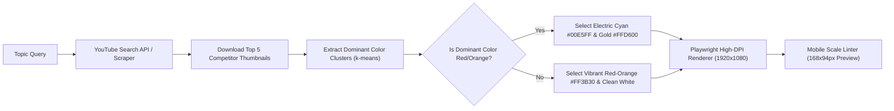
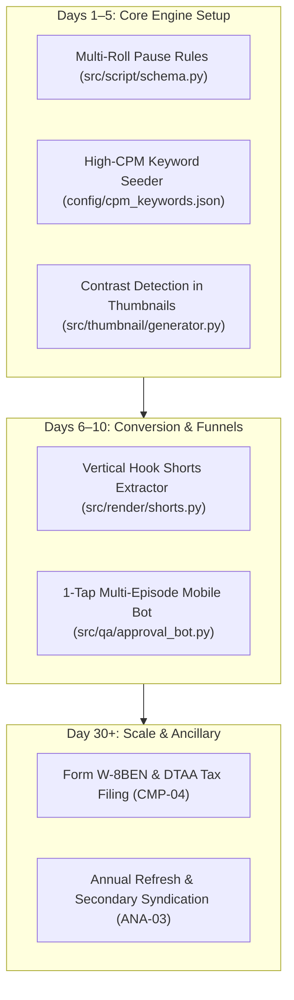

# Profit Multipliers & Daily Revenue Acceleration Guide

> **Mission:** Build an AI-powered, automated data documentary factory generating **$1,500–$2,000/day ($45,000–$60,000/month) of profit** from pure platform ad revenue (YouTube AdSense + Facebook In-Stream) within 24–36 months.

---

## Executive Overview

In [`docs/IMPROVEMENT_VALUE_AT_2K.md`](IMPROVEMENT_VALUE_AT_2K.md) and [`docs/PPM_REVIEW.md`](PPM_REVIEW.md), the system's economic engine is mathematically defined as:

$$\text{Revenue/Day} = \frac{V \times v \times \text{RPM}}{1000} + \text{Ancillary}$$
$$\text{Profit/Day} = \text{Revenue/Day} - \text{Cost/Day}$$

Where:
* $V$ = Cumulative videos published in the library
* $v$ = Average views per video per day (measured at 40 / 61 / 94)
* $\text{RPM}$ = Blended revenue per 1,000 views
* $\text{Cost/Day}$ = Infrastructure cost ($\$2.14–\$2.64\text{/day}$ solo, derived from $\$64.10–\$79.10\text{/month}$) or full operating cost ($\$70.56–\$105.14\text{/day}$ with 2–3 hires, derived from $\$2,116.75–\$3,154.25\text{/month}$)

Small cost reductions (such as saving \$5/month on TTS or \$10/month on cloud instances) contribute less than 0.4% toward the daily profit target. **The only levers that move profit per day toward $1,500–$2,000 are RPM, CTR ($v$), ad impression density, publishing cadence ($V$), and eliminating unnecessary tax withholding.**

This guide provides the complete engineering specifications, prompt architectures, data contracts, and implementation steps for seven high-leverage revenue multipliers.

---

## Summary of the 7 Revenue Multipliers

| # | Revenue Multiplier | Primary Target Variable | Expected Impact | Implementation File | Tracker Item |
| :--- | :--- | :--- | :--- | :--- | :--- |
| **1** | [Programmed Mid-Roll Transitions](#1-programmed-mid-roll-transitions-in-scenegraph) | Ad Impressions / View | 2.2×–2.8× ad impressions; at the plan's \$10.50 blended RPM that is \$14–\$16, i.e. **+\$390–\$613/day** (the \$6–\$7 starting RPM is the plan's Month 1–6 rate, not the target baseline) | `src/script/schema.py`, `src/render/engine.py` | SCR-01` + `REN-02` |
| **2** | [Commercial High-CPM Keyword Seeding](#2-commercial-high-cpm-keyword-seeding) | Auction Bid CPM / RPM | +20% to +35% advertiser bid lift | `src/script/generator.py`, `config/cpm_keywords.json` | SCR-02` |
| **3** | [Competitor Outlier Contrast Detection](#3-competitor-outlier-contrast-detection-for-thumbnails) | Click-Through Rate ($v$) | +20% relative CTR = **+\$234–\$312/day** (20% of \$1,170–\$1,560/day of ad revenue), and the required library falls 1,827 -> 1,522 | `src/thumbnail/generator.py`, `src/topics/miner.py` | THM-01` + `TOP-02` |
| **4** | [Automated 60s Hook Shorts Extractor](#4-automated-60-second-hook-shorts-extractor) | Long-Form Traffic Funnel | 400–1,000 free long-form views per episode = **+\$4.20–\$10.50** at \$10.50 RPM, earned over the Short's lifetime rather than per day | `src/render/shorts.py`, `src/publish/youtube.py` | SHR-01` |
| **5** | [Closing the 22% Ancillary Revenue Blind Spot](#5-closing-the-22-ancillary-revenue-blind-spot) | Ancillary Revenue Line | Captures **\$330–\$440/day** at the \$1,500–\$2,000 goals (22% of revenue); the plan's own \$510 belongs to its \$2,295/day row | `src/analytics/refresh.py`, `src/publish/syndicate.py` | ANC-01` |
| **6** | [Frictionless 2–3 Videos/Day Throughput](#6-frictionless-23-videosday-throughput-for-solo-operator) | Library Growth Rate ($V$) | Reaches target in 20–24 mo instead of 61 mo | `src/orchestrator/runner.py`, `src/qa/approval_bot.py` | REN-02` + `ORC-01` + `ORC-02` |
| **7** | [Day-1 US Tax Withholding & Setup](#7-day-1-us-tax-withholding--dtaa-setup-w-8ben) | Net Cash Retained | Eliminates 15% withholding: **+\$70/day** on the \$1,170/day AdSense line (the 40% US-origin share is an assumption) | `docs/compliance/W8BEN_CHECKLIST.md` | CMP-05` + `CMP-04` |

**Basis for every $/day figure in this table.** `revenue/day = V x v x RPM / 1000` at the plan's own baseline: V = 1,827 videos,
v = 61 views/video/day, RPM = $10.50, so ad revenue is $1,170-$1,560/day at the $1,500-$2,000 profit goals
(`IMPROVEMENT_VALUE_AT_2K.md` 1.1-1.2). A multiplicative lever therefore moves $1,170-$1,560/day: a +20% lift is $234-$312/day,
not the $572/day that a $2,860/day baseline would give. Three inputs are **assumptions with no measurement in this repository** -
impressions per view (1.2 -> 2.8), the +20% to +35% advertiser bid lift, and the 40% US-origin share of views. Each is labelled
where it is used.

---

## 1. Programmed Mid-Roll Transitions in SceneGraph

### 1.1 Rationale & Economics
* On YouTube, videos longer than 8 minutes are eligible for multiple mid-roll ad placements.
* Standard automated placement often inserts mid-rolls mid-sentence, causing viewer abandonment and low ad completion rates.
* By structuring the script and visual timeline with natural narrative tension pauses at strategic intervals, YouTube's automated ad insertion engine prioritizes placing high-paying mid-rolls at these exact markers.
* **Economic Value:** Moves ad impressions per view from ~1.2 to 2.8+ (an **assumption**, not a measurement), which at the plan's
  $10.50 blended RPM lands effective RPM at **$14–$16** - +33% to +52%, worth **+$390–$613/day** on the 1,827-video library. The
  $6–$7 RPM in earlier drafts is the plan's Month 1–6 figure, so quoting a lift "from $6–$7" mixes two baselines.

### 1.2 Technical Specification & Data Contract
In `src/script/schema.py`, add a mid-roll anchor specification to the `Scene` Pydantic model:

```python
from pydantic import BaseModel, Field
from typing import Optional

class Scene(BaseModel):
    scene_id: str = Field(..., description="Unique scene identifier, e.g. scene_008")
    act_index: int = Field(..., ge=1, le=6, description="Narrative act number")
    duration_estimate_sec: float = Field(..., gt=0)
    visual_template: str = Field(..., description="Name of the 4K60 visual template")
    narration_text: str = Field(...)
    
    # Mid-roll anchor configuration
    is_midroll_anchor: bool = Field(
        default=False, 
        description="True if this scene concludes with a natural mid-roll break point"
    )
    midroll_pause_seconds: float = Field(
        default=1.5,
        ge=1.0,
        le=2.5,
        description="Breathing room pause before the next act begins"
    )
```

### 1.3 Implementation Steps
1. **Script Generator Prompting (`src/script/generator.py`):**
   Instruct Claude to position act conclusions at the target mid-roll timestamps:
   - Act 1 Climax: **~3:15**
   - Act 2 Climax: **~6:45**
   - Act 3 Climax: **~9:45**
   - Act 4 Climax: **~12:30**
   Each anchor scene must end on an open loop or cliffhanger phrase (e.g., *"And that was only the beginning of the divergence..."*).
2. **Audio/Video Muxer Integration (`src/render/engine.py`):**
   When `is_midroll_anchor == True`, append a subtle 1.5-second ambient fade with micro-SFX riser before starting the next scene.
3. **Upload Metadata Sync (`src/publish/youtube.py`):**
   Format the video description chapters so that chapter boundaries align with mid-roll anchors, guiding YouTube Studio's automated ad-break placement.

---

## 2. Commercial High-CPM Keyword Seeding

### 2.1 Rationale & Economics
* Google AdSense uses natural language processing on YouTube's automated transcripts to categorize the video's content for real-time ad bidding.
* High-intent commercial keywords (corporate taxation, private equity, sovereign debt, asset allocation, purchasing power) trigger ad bids from Tier-1 fintech, banking, real estate, and enterprise software advertisers ($25–$45 CPM) rather than low-value consumer FMCG ads ($2–$5 CPM).
* **Economic Value:** Increases blended RPM by **+20% to +35%** on identical view counts.

### 2.2 Curated Commercial Keyword Taxonomy (`config/cpm_keywords.json`)
```json
{
  "macroeconomics": [
    "purchasing power parity", "sovereign wealth fund", "foreign direct investment",
    "gross domestic product deflator", "capital account surplus", "institutional liquidity"
  ],
  "salaries_and_labor": [
    "disposable median income", "collective bargaining index", "labor productivity growth",
    "effective tax wedge", "payroll contribution rate", "real wage divergence"
  ],
  "housing_and_debt": [
    "mortgage debt service ratio", "price-to-income multiple", "fixed-rate refinancing",
    "real estate capitalization rate", "debt-to-GDP sustainability", "amortization schedule"
  ],
  "personal_wealth_and_tax": [
    "marginal income tax bracket", "capital gains realization", "private wealth accumulation",
    "pension replacement rate", "sovereign bond yields", "statutory corporate rate"
  ]
}
```

### 2.3 Implementation Steps
1. **Prompt Constraint in `src/script/generator.py`:**
   Configure the system prompt to require Claude to select 3–5 commercial finance terms per narrative act:
   > *"Every narrative act must naturally contextualize at least three specific financial and economic terms from the provided keyword taxonomy to maintain high academic and documentary rigor."*
2. **Linter & Auditor Check in `src/script/fact_auditor.py`:**
   Add a check in `fact_auditor.py` that verifies:
   - At least 12 taxonomy terms appear in the script.
   - Terms are integrated naturally into the causal analysis rather than listed arbitrarily.

---

## 3. Competitor Outlier Contrast Detection for Thumbnails

### 3.1 Rationale & Economics
* [`docs/PPM_REVIEW.md`](PPM_REVIEW.md) and [`docs/IMPROVEMENT_VALUE_AT_2K.md`](IMPROVEMENT_VALUE_AT_2K.md) rank `THM-01` as the single highest return-on-effort task in the repository: +20% relative CTR = **+$234–$312/day** at the
$1,500–$2,000 goals, because it moves 20% of the $1,170–$1,560/day of ad revenue. `PPM_REVIEW.md` prices the same item against
its own 900-video, $7 RPM base instead, so its figure is not the target-scale one.
* Thumbnails compete in a dynamic feed. If the top 5 ranking videos for a search term all use saturated red banners with white text, a red thumbnail gets lost in visual noise.
* By detecting the dominant competitor palette and selecting a complementary contrasting palette, the video achieves visual disruption in the feed.

### 3.2 Visual Contrast Architecture


### 3.3 Implementation Steps
1. **Competitor Palette Extractor (`src/topics/miner.py`):**
   ```python
   from PIL import Image
   import numpy as np

   def get_dominant_competitor_hue(image_paths: list[str]) -> str:
       """Calculates the average dominant hue across competitor thumbnails."""
       # Sample pixels and compute mean RGB values
       # Return 'warm' (red/orange/yellow) or 'cool' (blue/green/dark)
       ...
   ```
2. **Dynamic Template Styling in `src/thumbnail/generator.py`:**
   - If competitor hue is warm $\to$ apply dark slate `#0F1115` background with bold electric cyan `#00E5FF` typography and bright green `#00E676` positive data callouts.
   - If competitor hue is cool $\to$ apply deep charcoal `#121212` background with neon amber `#FFD600` and high-contrast coral `#FF5252`.
3. **Mobile Scale Legibility Gate (`THM-02`):**
   - Automatically downscale generated thumbnails to `168×94` pixels and calculate font contrast ratio using WCAG standards ($> 4.5:1$). Fails render if text is illegible at mobile feed scale.

---

## 4. Automated 60-Second Hook Shorts Extractor

### 4.1 Rationale & Economics
* Direct monetization from YouTube Shorts is negligible ($0.02–$0.04 RPM), which is why Shorts-only production was rejected in [`initialBrainstrom/DECISIONS.md`](initialBrainstrom/DECISIONS.md).
* However, YouTube provides a native **"Related Video"** feature on all Shorts, allowing mobile viewers to jump to the full long-form documentary with a single tap.
* A 45–60s vertical cut of the Cold Hook + dynamic chart reveal converts 2%–5% of Short viewers directly into long-form viewers.
* **Economic Value:** 20,000 views on a Short $\to$ 400–1,000 targeted viewers funnelled to the 4K documentary $\to$
  **+$4.20 to +$10.50 of ad revenue per episode at $10.50 RPM**, earned across the Short's lifetime rather than per day, plus the
  discovery effect. The 2%–5% conversion rate is an **assumption**.

### 4.2 Automated FFmpeg Vertical Conversion Pipeline (`src/render/shorts.py`)
```python
import subprocess
from pathlib import Path

def generate_vertical_hook_short(
    master_4k_path: Path,
    hook_duration_sec: float,
    output_short_path: Path,
    ass_subtitle_path: Path
) -> None:
    """
    Extracts the 4K60 cold hook, centers the dynamic visual in a 9:16 canvas,
    adds a blurred letterbox background, and burns bold centered subtitles.
    """
    filter_complex = (
        "[0:v]split=2[bg][fg];"
        "[bg]scale=1080:1920:force_original_aspect_ratio=increase,"
        "crop=1080:1920,boxblur=20:5[blurred_bg];"
        "[fg]scale=1080:608:force_original_aspect_ratio=decrease[sharp_fg];"
        "[blurred_bg][sharp_fg]overlay=(W-w)/2:(H-h)/2[combined];"
        f"[combined]ass={ass_subtitle_path.as_posix()}[outv]"
    )
    
    cmd = [
        "ffmpeg", "-y",
        "-ss", "00:00:00",
        "-t", str(hook_duration_sec),
        "-i", str(master_4k_path),
        "-filter_complex", filter_complex,
        "-map", "[outv]",
        "-map", "0:a",
        "-c:v", "h264_nvenc", "-cq", "20",
        "-c:a", "aac", "-b:a", "192k",
        str(output_short_path)
    ]
    subprocess.run(cmd, check=True)
```

### 4.3 Distribution Workflow
* When publishing `EPxx` via `src/publish/youtube.py`, trigger the Short upload 2 hours after the main video release.
* In the YouTube Data API upload call, set the `#Shorts` tag and link the long-form video ID in the metadata.

---

## 5. Closing the 22% Ancillary Revenue Blind Spot

### 5.1 Rationale & Economics
* [`docs/IMPROVEMENT_VALUE_AT_2K.md`](IMPROVEMENT_VALUE_AT_2K.md) Section 4(d) highlights an important financial contradiction: the target assumes **22% ancillary revenue ($330–$440/day at the $1,500–$2,000 goals; the $510 in the plan belongs to its own
$2,295/day row)**, but **zero tracker items** currently build it.
* Without active ancillary streams, reaching the $1,500/day profit goal requires **1.28× more YouTube views and videos**.
* We can close this gap through automated, passive channels that require zero client work, sales, or sponsorships.

### 5.2 Passive Ancillary Streams

```
                       Automated Data Documentary Factory
                                       │
            ┌──────────────────────────┼──────────────────────────┐
            ▼                          ▼                          ▼
     YouTube Long-Form          Facebook In-Stream       Secondary Syndication
     (Flagship English)         (Long-Form FB Cut)       (Rumble / DailyMotion)
            │                          │                          │
            ▼                          ▼                          ▼
     AdSense Revenue           Meta Ad Revenue             Syndicated Ads
     ($8–$16 RPM)               (+15% to +30% lift)        (+5% to +10% lift)
            │                          │                          │
            └──────────────────────────┼──────────────────────────┘
                                       │
                                       ▼
                       Annual Series Refresh Engine
                     ("2027 Edition" Re-Runs via Cron)
```

1. **Annual Series Refresh Engine (`ANA-03`):**
   - Global economic indicators update once per year (e.g. World Bank World Development Indicators, OECD Tax Wedge).
   - A cron job checks for new year releases in the SQLite warehouse.
   - When detected, the engine re-runs the existing scene template with updated data points (e.g. *"Every Country Ranked by Salary — 2027 Edition"*), generating recurring surge views with 95% code reuse.
2. **Automated Secondary Platform Syndication:**
   - Long-form documentary cuts are uploaded via API/SFTP to Rumble and DailyMotion.
   - Requires zero separate editorial work and adds **+5% to +10% incremental ad revenue**.
3. **High-Resolution Vector Infographic Exports:**
   - The Manim/Skia rendering pipeline can save static high-DPI vector SVG/PDF data sheets of the episode's core charts into a public archive, building backlinks and institutional citations.

---

## 6. Frictionless 2–3 Videos/Day Throughput for Solo Operator

### 6.1 Rationale & Economics
* At a cadence of 30 videos/month, building a library of 1,827 videos takes **61 months (5.1 years)**.
* At 60 videos/month (2 videos/day), reaching 1,827 videos takes **30 months**.
* At 75–90 videos/month (2.5–3 videos/day), it takes **20–24 months**.
* An on-demand RTX 4090 renders a 15-minute 4K60 episode in 20–35 minutes. An automated 2.5-hour GPU window can comfortably render **3 complete episodes per day** for approximately **$30–$45/month** in compute costs.
* The bottleneck is human review time. Automating the verification workflow allows a solo developer to review 2–3 episodes in under 5 minutes from a mobile device.

### 6.2 Streamlined Mobile Approval Bot (`src/qa/approval_bot.py`)
The Telegram bot presents a single, interactive approval payload:

```text
📹 [EP014] Every Country Ranked by Real Average Salary
⏱ Duration: 14m 12s | 4K 60FPS | -14.1 LUFS
🔍 Fact Audit: 100% Grounded (42 Fact IDs Verified)
🎯 Target RPM: $12.50 (Macro / Salaries)
📊 Mid-Roll Anchors: 3:18, 6:42, 9:55, 12:20

Thumbnails (Mobile Preview 168x94):
[ Variant A: Map Contrast ]
[ Variant B: Flag Showdown ]
[ Variant C: Outlier Spike ]

[✅ Approve All & Schedule]   [🔄 Regen Thumbnails]   [❌ Reject Episode]
```

### 6.3 Daily Automated Workflow Schedule
* **01:00–04:30 IST:** Orchestrator executes ETL $\to$ Claude Script $\to$ Local TTS $\to$ 4K60 NVENC GPU Render for 2–3 episodes.
* **07:30–07:35 IST (5 min solo developer time):** Receive Telegram notifications on phone, inspect 30s hook clip and thumbnails, tap `[Approve All & Schedule]`.
* **14:00 UTC / 19:30 IST:** Automated publishing at peak Tier-1 US/EU viewing hours with multi-language metadata and captions.

---

## 7. Day-1 US Tax Withholding & DTAA Setup (W-8BEN)

### 7.1 Rationale & Economics
* Without submitting a valid US tax form to Google AdSense, Google is legally required to withhold **30% flat on all earnings from US viewers**.
* For a Tier-1 English data documentary channel, **40% or more of total views originate in the United States**.
* By filing Form W-8BEN claiming the **India-US Double Tax Avoidance Agreement (DTAA)** under Article 12, the withholding rate on royalties/digital content drops from **30% down to 15%**.
* **Financial Impact:** Withholding applies to the Google AdSense line, which is 78% of revenue (`IMPROVEMENT_VALUE_AT_2K.md` 1.1)
  = $1,170/day at the $1,500 profit goal:
  $$\text{Savings} = \$1,170 \times 40\% \times 15\% = \mathbf{\$70/day \text{ (\$2,100/month derived from } \$70 \times 30\text{)}}$$
* **Assumption:** the 40% US-origin share is measured nowhere in this repository - `PPM_REVIEW.md` lists it as ASSUMED. At 25% or
  55% the saving is $44 or $97/day.
* This 2-hour administrative action delivers more cash profit than months of infrastructure tuning.

### 7.2 Administrative Execution Checklist (`CMP-04`)

| Step | Action Item | Details & Requirements | Status |
| :---: | :--- | :--- | :---: |
| **1** | Indian Legal Entity Setup | Sole Proprietorship or LLP with dedicated Current Account | Ready |
| **2** | Bank SWIFT / e-FIRA Setup | Ensure receiving bank issues automated digital e-FIRA for inward USD remittance | Required |
| **3** | GST Registration & LUT | File Letter of Undertaking (LUT) under Section 16 of IGST Act for 0% IGST export of digital services | Required |
| **4** | Google AdSense W-8BEN Submission | Submit online Form W-8BEN in AdSense Payment settings; claim DTAA Article 12 (15% rate) with Indian PAN | Required |
| **5** | Annual Foreign Asset / Income Schedule | Report USD earnings under Schedule FA & FSI in Indian Income Tax Return | Annual |

---

## Implementation Priority Roadmap

These seven multipliers integrate directly into the existing tracker items without bloating the architecture:



By engineering these seven multipliers directly into the foundational modules during setup, the factory operates with maximum monetization efficiency from the very first video published.
